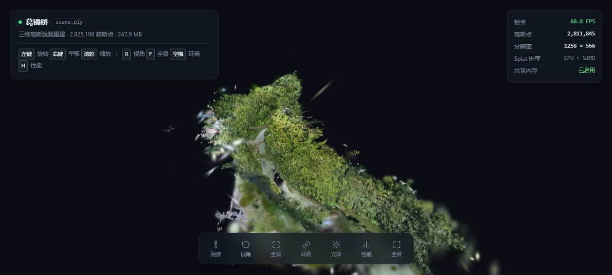
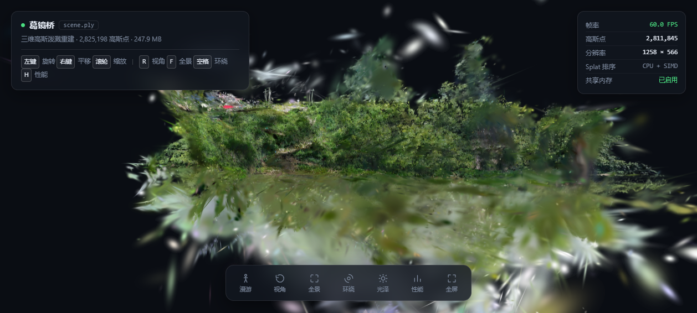
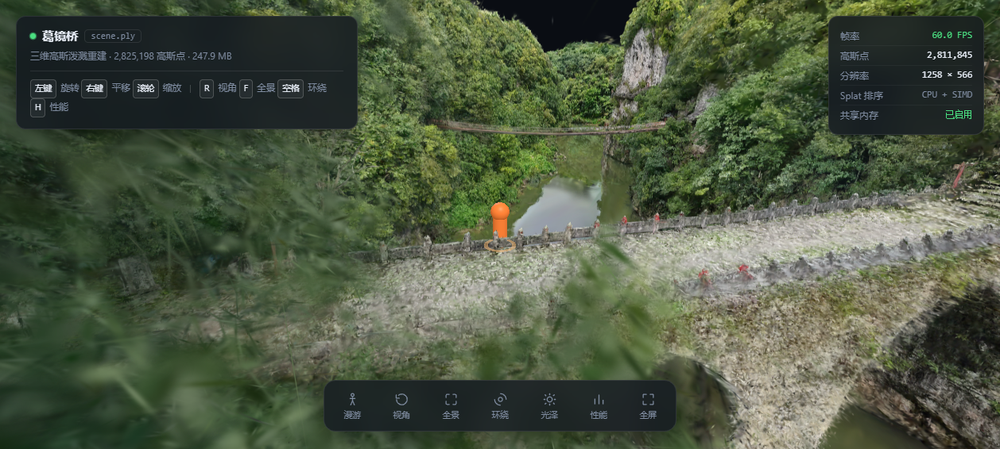

# 葛镜桥 · 三维高斯场景网页查看器

把 `scene.ply`（3D Gaussian Splatting 重建结果）搬进浏览器，支持轨道浏览，
并为后续「人物在场景中行走」的交互留好了扩展位。



*281 万高斯点 · 1080p 稳定 60 FPS*

---

## 快速开始

**方式一（推荐）：双击 `启动服务器.bat`**

脚本会自动找到可用的 Python（绕开下面那个「应用执行别名」的坑），
启动服务器并自动打开浏览器，无需任何手工配置。

**方式二：命令行**

```bash
cd web
python tools/serve.py        # 默认 8123 端口
```

若提示 `Python was not found; run without arguments to install from the Microsoft
Store`，说明 `python` 命令落到了 Microsoft Store 的占位符上（见下方「踩过的坑 4」），
换用下面任一条即可：

```bash
py tools/serve.py                                      # 用 py 启动器
"%LOCALAPPDATA%\Programs\Python\Python310\python.exe" tools/serve.py   # 用完整路径
```

然后浏览器打开 **http://localhost:8123/**

首次进入需要下载 248 MB 模型数据，加载完成后会显示场景与操作界面。

> **两个不要做**：
> 1. 不要直接双击 `index.html`。`file://` 协议下浏览器会拦截 ES module 和模型请求，页面会一直卡在加载界面。
> 2. 不要图省事用 `python -m http.server`。它有 MIME 类型和并发两个坑，原因见下方「踩过的坑」。

---

## 目录结构

> ### ⚠️ 2026-10-06 形态变更 —— 先读这段再看下面的树
>
> 网页已改为「天空 + 无人机航拍」形态。**人物漫游（`V` 键）与网格/泼溅切换（`M` 键）已整体删除**：
> `js/terrain.js`、`js/character.js` 已**不再被任何文件 import**，`ui.js` 里也没有对应的按钮与快捷键分支，
> `config.js` 里没有 `mesh` / `roaming` 节。下面树里凡标「~~已移除~~」的行都是**历史遗留**，
> 对应的模型产物还留在 `models/` 备用，但**通路（代码）已经不存在** —— 想恢复必须重写
> `viewer.loadMesh` + `ui` 的 mesh 分支 + `config.mesh` / `config.roaming`，
> 并遵守本文「坐标系」与「尺度」两节的全部约束。
>
> 当前实际可用的交互只有：泼溅渲染、无人机自由飞行（WASD/QE/Shift）、天空、视角光泽、
> 高光压白、截图入库、背景音乐、性能面板、全屏。详见「操作方式」一节。

```
web/
├── 启动服务器.bat          一键启动：自动定位 Python + 起服务 + 开浏览器
├── index.html              页面骨架 + importmap 依赖映射（📷 截图钮 + 🎵 音乐钮）
├── css/style.css           界面样式（深色，为凸显高斯光影层次）
├── js/
│   ├── config.js           ★ 所有可调参数集中在此，调优只改这个文件
│   ├── viewer.js           三维核心：渲染器 / 相机 / 模型加载 / 渲染循环 / 截图抓帧
│   ├── environment.js      three r170 Sky（顶部穹顶 + 下半「砚台」暗穹）
│   ├── drone.js            SkyPath 式无人机航拍运镜
│   ├── snapshot.js         右上角 📷 → POST 到文创后端 3001
│   ├── music.js            背景音乐播放/暂停（z-index 60，加载时即可点）
│   ├── ui.js               界面层：加载进度、性能面板、工具栏、快捷键
│   ├── main.js             装配入口
│   ├── terrain.js          ~~已移除~~（漫游用地面高度查询；现无任何 import）
│   └── character.js        ~~已移除~~（漫游角色移动/贴地/转向；现无任何 import）
├── vendor/                 依赖（已本地化，离线可用，不依赖 CDN）
│   ├── three.module.js
│   ├── gaussian-splats-3d.module.js
│   └── three/addons/       OrbitControls、GLTFLoader、Sky
│       └── objects/Water.js ~~已移除~~（水面反射已删，无人引用）
├── models/
│   ├── scene.ply           ★ 唯一在线加载的模型（247.9 MB）
│   ├── scene_mesh_2dgs.glb 备用（2DGS 网格；仅 __glbtest.html 引用）
│   ├── scene_mesh_tex.glb  备用（旧 40 机位烘焙贴图版）
│   ├── scene_mesh.ply      ~~已移除~~（M 键网格模式用的三角网格）
│   ├── heightmap.json      ~~已移除~~（漫游用地面高度图，256×256 / p80）
│   └── waternormals.jpg    ~~已移除~~（水面法线，随水面一起下线）
└── tools/
    ├── serve.py            开发服务器（COOP/COEP 头 + MIME 修正 + 端口自增）
    ├── gs_to_mesh.py       高斯泼溅 → 三角网格（表面采样 + 泊松重建 + 顶点色）
    ├── inspect_ply.py      PLY 解析：顶点数、属性、坐标范围、不透明度分布
    ├── build_heightmap.py  从点云生成地面高度图（--rot 与网页端朝向修正保持一致）
    ├── analyze_shot.py     截图分析：判断画面里是否真的有内容
    ├── colmap_up_axis.py   ★ 用 SfM 相机位姿判定世界坐标系的「上」方向
    ├── verify_frame.py     ★ 用俯视轮廓互相关确定 PLY 与 SfM 坐标系的旋转关系
    ├── verify-music.mjs    无头 CDP 验证背景音乐按钮
    └── test_up_axis.py     几何+颜色的启发式判据（会矛盾，仅作参考，勿单独采信）
```

> 📌 **文档与代码不符时，以 `.workbuddy/memory/MEMORY.md` 的「网页形态变更（2026-10-06）」为准。**
>
> ⚠️ **一处已更正的错误声明**：本 README 早前称 `models/scene.ply` 是「硬链接指向项目根目录的 scene.ply，
> 不占额外磁盘」。**实测不成立**：`fsutil hardlink list` 只列出它自己一个名字，全项目也只有这一份
> `scene.ply`（259,918,795 B），项目根目录并没有同名文件 —— 它**确实实占 248 MiB**。
> 该文件此前被移出 `js/` 段落，现一并更正。

---

## 操作方式

| 操作 | 方式 |
|---|---|
| 旋转 | 左键拖动 |
| 平移 | 右键拖动 |
| 缩放 | 滚轮 |
| 重置视角 | `R` 或底部「视角」 |
| 适配全景 | `F` 或底部「全景」 |
| 自动环绕 | `空格` 或底部「环绕」 |
| 视角光泽开关 | `G` 或底部「光泽」 |
| **无人机飞行** | `D` 或底部「飞行」（**当前主交互**；就绪后 1.2 秒自动进入） |
| 无人机移动 / 升降 | `W` `A` `S` `D` / `Q` `E`，按住 `Shift` 加速，拖动转向，滚轮调速 |
| 退出飞行 | `D` |
| 截图 → 文创素材库 | 右上角 📷 |
| 背景音乐播放 / 暂停 | 右上角 🎵 |
| **实时语音对话** | 右上角 🎤（模型就绪后浮出；点一下开始，再点或面板里「结束对话」收尾） |
| 性能面板 | `H` 或底部「性能」 |
| 全屏 | 底部「全屏」 |
| ~~网格 / 泼溅切换~~ | ~~`M` 或底部「网格」~~ —— **已移除**（代码里已无此分支） |
| ~~进入 / 退出漫游~~ | ~~`V` 或底部「漫游」~~ —— **已移除** |
| ~~漫游中移动 / 奔跑~~ | ~~`WASD` / `Shift`~~ —— **已移除** |

> ⚠️ README 与代码冲突时以代码为准：`index.html` 的工具栏与 `js/ui.js` 的快捷键分支是唯一事实来源。
>
> 📌 **页面 HUD 的一处小缺口（已知未修）**：`index.html` 顶栏的快捷键提示里**没有列 `G`（视角光泽）**，
> 但 `js/ui.js` 确实实现了它。快捷键完整清单以本文上表 + `ui.js` 为准。

---

## 实时语音对话（豆包 Seeduplex 3.0）

右上角 🎤 点一下就能和「沧朔」说话 —— 它边听边答，回复的文字同步显示在面板里。
麦克风全程开着（全双工），你随时可以开口打断它。

### 架构：为什么多了一层 Node 代理

```
浏览器   http://localhost:8123          （Python 静态服务，仍是唯一入口）
   │  ws://127.0.0.1:8124/voice-proxy    ← 不带任何凭据
   ▼
tools/voice-proxy.mjs                   （Node 本机代理，凭据只在这一层）
   │  wss://openspeech.bytedance.com/api/v3/duplex/realtime/dialogue
   ▼
豆包实时语音 3.0
```

**凭据绝不能进浏览器。** 苏州双桥当年把 `appId` / `accessToken` / `secretKey` 硬编码在
`RealtimeDialog-Web/config.js` 里，而那个文件会被浏览器直接下载 —— 等于把密钥发给
每一个访客（见《项目现状体检报告》H6）。所以这里浏览器只连本机代理，
密钥只存在于 `贵州葛镜桥/.env` 和代理进程里；前端能从 `/voice-config` 拿到的
只有人设、音色、采样率这类**非机密**参数。

### 为什么是零依赖

葛镜桥是纯静态站点，没有 `package.json`、没有 `node_modules`，靠 Python 标准库起服务。
为了不引入 `npm install`，代理里的 **WebSocket 握手与帧编解码是手写的**，只用 Node 标准库。
协议本身是 JSON 文本帧，所以只需要处理文本帧和控制帧。

> 苏州双桥那套是 `ws` 包 + 4 字节二进制协议头，与 Seeduplex 新协议不是一回事，两套代码不通用。

### 为什么没改任何 `.bat`

`启动服务器.bat` 与 `启动全部场景.bat` 都只调 `tools/serve.py`，
所以让 serve.py 顺手把代理拉起来当子进程就够了，两个入口全覆盖。
（根启动器是 GBK 编码的，动它容易把中文注释读乱 —— 能不改就不改。）
serve.py 退出时会把代理一并收掉，不留孤儿进程占着 8124。

### 配置

`cp .env.example .env`，至少填一组凭据：

| 变量 | 说明 |
|---|---|
| `VOICE_API_KEY` | 【新版控制台】**推荐**。对应上游请求头 `X-Api-Key` |
| `VOICE_APP_ID` / `VOICE_ACCESS_TOKEN` / `VOICE_APP_KEY` | 【旧版控制台】三件套，文档称仍兼容 |
| `VOICE_SPEAKER` | 音色 ID，默认 `zh_female_vv_jupiter_bigtts`（官方预置）。**复刻音色见下方说明** |
| `VOICE_INSTRUCTIONS` | 系统提示词，决定「沧朔」的人设与说话风格 |
| `VOICE_GREETING` | 开场白。留空则不主动开场，由用户先说 |
| `VOICE_PROXY_PORT` | 代理端口，默认 8124 |

> ⚠️ **复刻音色（`S_` 前缀）不能跨账号用 —— 填错会让整个语音对话废掉。**
>
> 实测把 `VOICE_SPEAKER` 填成苏州双桥用的 `S_tYw86oeY1` 时，上游在 `session.create`
> 阶段**直接拒绝整个会话**：
>
> ```json
> {"type":"error","code":"55000000",
>  "message":"resource ID is mismatched with speaker related resource"}
> ```
>
> `S_` 开头是**声音复刻**音色（预付费音色槽位），属于某个账号 / 资源专有；换
> `X-Api-Resource-Id` 也救不回来（`volc.speech.dialog` / `volc.megatts.voiceclone` /
> 完全不传，三种都试过，报错一字不差）。官方预置音色则一切正常。
>
> 要用复刻音色，请到火山控制台**「声音复刻」**页拿**你自己账号**的音色槽位 ID
> （形如 `S_xxxxxxxx`）填进 `VOICE_SPEAKER`。`.env` 是现读的，保存后刷新网页就生效。

### 自检与排查

```bash
# 连通性自检：连上游 → 发 session.create → 打印回包
node tools/voice-proxy.mjs --probe

# 离线自检：起一个模拟上游（不连真实服务、不用凭据），用来验浏览器这一侧
node tools/voice-proxy.mjs --mock --port 8199
# 再开一个终端，把代理指向模拟上游：
#   PowerShell:  $env:VOICE_ENDPOINT='ws://127.0.0.1:8199/'; node tools/voice-proxy.mjs
```

上游拒绝时对照这张表：

| 返回 | 含义 | 怎么修 |
|---|---|---|
| `401` `45000010 Invalid X-Api-Key` | 密钥无效 | 检查 `.env` 里的 Key |
| `403` `45000030 requested resource not granted` | **密钥有效，但账号没开通「实时对话式 AI」** | 火山引擎控制台 → 语音技术，开通该服务；并确认 Key 是在**开通了该服务的账号**下、于新版控制台「API Key 管理」里建的。Key 若是为 TTS / ASR 等别的语音服务建的，对这个资源就是没有授权 |

> 💡 两个排查开关：`--resource none` 可以不带 `X-Api-Resource-Id` 再试；
> `--key <value>` 可以临时换一把密钥 —— 拿一把乱填的 Key 对比一下，
> 就能立刻分清「密钥错（401 45000010）」和「服务没开通（403 45000030）」。

### 音频规格（必须严格对齐，否则服务端直接报错）

| 方向 | 格式 | 采样率 | 分片 |
|---|---|---|---|
| 上行 | `pcm`（16 位有符号小端） | 16000 Hz 单声道 | **20 ms / 320 采样 / 640 字节** |
| 下行 | `pcm_s16le` | 24000 Hz 单声道 | 由服务端决定 |

上行分片在 `AudioWorklet`（`js/pcm-worklet.js`）里**按采样数**切，刻意不用定时器：
248 MB 高斯场景一卡，定时器就会飘，而文档明确写着「发送速率过快或过慢都将触发服务端错误」。

另外模型靠上行音频流保活 —— **一旦断流，服务端等不到音频就会超时，模型不再响应**。
所以静音时（点了「静音」按钮、或页面切到后台）客户端**照旧每 20 ms 发一包**，
只是内容换成同长度的全零帧。这也是官方 Demo 的做法。

另外还有一层**保活看门狗**：上行正常由 AudioWorklet 在音频线程里产出，但音频线程本身
可能被卡住（页面节流、渲染进程过载）。实测在无头浏览器里跑约半分钟，服务端就抛
`AudioServerNoAudioInputTooLongError`（`52000033`）并**直接关掉整个会话**。
所以 `js/voice.js` 加了兜底：只在「超过 200 ms 没发帧」时才补发静音帧，
**正常路径一行都不改** —— 刻意没改成定时器驱动，就是为了不破坏音频线程那套精确节奏。

> 文档里提到的 `input_audio_mute.commit` / `input_audio_unmute.commit` 本实现**没有采用** ——
> 官方 Demo 全程只靠「每 20 ms 一包」保活，跟它保持一致更稳。

### 协议对齐：照官方 Demo，别照文档猜

文档把 `session.create` 写成扁平列表，层级很容易猜错。这份实现是照
**官方 Seeduplex Web Demo**（`web_duplex_demo/server.py` 的 `_build_session_create`）
逐字段对齐的 —— 我第一版凭文档猜，**错了三处**：

| 字段 | 凭文档猜（错） | 官方写法（对） |
|---|---|---|
| 采样率键名 | `format.rate` | `format.sample_rate` |
| 音色位置 | `session.voice` | `session.audio.output.voice` |
| `extension` 位置 | 嵌在 `session` 里 | **`session` 的同级** |

正确报文：

```jsonc
{
  "type": "session.create",
  "session": {
    "model": "1.2.6.1",
    "instructions": "……",
    "audio": {
      "input":  { "format": { "type": "pcm",       "sample_rate": 16000 } },
      "output": { "format": { "type": "pcm_s16le", "sample_rate": 24000 },
                  "voice": "zh_female_vv_jupiter_bigtts",
                  "speed": 0, "loudness": 0 }
    }
  },
  "extension": { "extra": { "enable_proactive_speak": false } }
}
```

> 官方 Demo 默认输出 `ogg_opus`（它用 MediaSource / WebCodecs 播放）。本项目要的是
> `pcm_s16le` —— 文档明确支持，且 PCM 不需要解码器。客户端收到第一包音频时会验一下文件头：
> 若发现是 Ogg Opus，会**直接报出来**而不是放出噪音。

`--mock` 模式内置了这份形状的**断言**：字段写错会立刻打印出具体哪一项不对，
所以即使账号还没开通，协议写错也逃不掉。

**下行事件的字段名同样不唯一**，也是照官方抄的：

```js
// 文字（官方 extractEventText）
event.text || event.delta || event.transcript || event.content || ""
// 音频（官方 enqueueOutputAudio）
event.audio || event.delta || ""
```

少写一个兜底**不会报错**，只会表现为「面板一片空白」或「听不到声音」——
这两种症状最难往协议上想，所以宁可多写几个 `||`。

顺带两处已核对一致、不需要改的地方：

- **PCM 解释**：官方 `PcmStreamPlayer` 用 `view.getInt16(i * 2, true) / 32768`、24 kHz 播放
  （`app.js:2348`），与 `js/voice.js` 完全一致。
- **`pcm_s16le` 是官方支持的路径**：`app.js:2796` 里就有 `PcmStreamPlayer(24000)` 这一支，
  所以选它不是猜测（官方默认走 `ogg_opus`，只是因为它顺带演示 MediaSource / WebCodecs）。
- **握手头**：官方只发 `Host` / `Upgrade` / `Connection` / `Sec-WebSocket-Key` /
  `Sec-WebSocket-Version` + 鉴权头，**没有 Origin、没有子协议**，与 `voice-proxy.mjs` 一致。

### 涉及的代码

| 文件 | 作用 |
|---|---|
| `js/voice.js` | 浏览器端：Seeduplex 事件状态机 + 麦克风采集 + 音频播放 + 面板渲染 |
| `js/pcm-worklet.js` | AudioWorklet：把 16 kHz 浮点采样按 20 ms 切成 Int16 PCM |
| `tools/voice-proxy.mjs` | Node 代理：零依赖 WebSocket + 凭据注入 + `/voice-config`，带 `--probe` / `--mock` |
| `tools/serve.py` | 顺带以子进程拉起代理，退出时一并收掉 |

> ✅ **已验证**：服务开通后，用一段**真实中文人声**（系统 TTS 合成，经 Chrome
> `--use-file-for-fake-audio-capture` 喂进假麦克风）跑通了真实链路 ——
> 真实 ASR 识别 → 真实模型回答 → 真实 TTS 音频回传，45 秒内完成 4 轮问答，
> 回答内容准确（葛镜、倾尽家财、三建三成、麻哈江、万历年间、「南有葛镜桥」）。
>
> ⚠️ **仍未验证的一点：是否真的出声。** 无头环境没有声卡，我只能证明下行音频被正确
> 解包、进入播放队列且无报错。请在真实浏览器里听一下确认。

---

## 技术方案

**渲染**：Three.js `r170` + `@mkkellogg/gaussian-splats-3d@0.4.7`

没有使用渲染库自带的 `Viewer`（它自带相机、渲染器和一套 UI，很难二次扩展），
而是用它的 `DropInViewer` —— 本质是一个 `THREE.Group`，可以塞进自己的 Three.js 场景。
这样后续加人物模型、做地面碰撞、写射线检测都有落脚点。

**模型实测数据**（由 `tools/inspect_ply.py` 得出）：

| 项目 | 数值 |
|---|---|
| 高斯点数 | 2,825,198（经 alpha 阈值筛选后参与渲染 2,811,845） |
| 文件大小 | 247.88 MB |
| 球谐阶数 | 1（9 个 `f_rest` 系数） |
| 每点字节 | 92 |
| 资产坐标系有效范围 | X 2.48 / Y 0.46 / Z 1.97 |
| 世界坐标系场景中心 | (0.398, −0.027, −0.436) |
| 资产竖直轴 | **−Y（上下颠倒）**，需绕 X 轴转 180°，见「坐标系」一节 |

Y 轴跨度最小，说明 Y 就是竖直轴；但它的**方向是朝下的**，所以加载时要做一次
朝向修正 —— 这是本项目最容易踩、也最隐蔽的坑，完整推导见下方「坐标系」。

**实测性能**：1080p 视口下稳定 **60 FPS**，加载耗时约 **7.8 秒**（本地磁盘）。

---

## 坐标系：模型是上下颠倒的

**现象**：模型加载后视角完全倒置 —— 植被像胡须一样从地面向下垂，整个场景像
挂在天花板上。这不是相机或控制器的问题，是 `scene.ply` 自身的竖直轴指向 **−Y**。

**为什么不能靠肉眼猜**：高斯泼溅是一张「薄片」，而高斯椭球本身前后对称，
从正上方看和从正下方看覆盖率几乎一样（实测 53.48% vs 53.29%），
所以「哪边朝上」无法从单张渲染图判断。我最初用「地面比树冠平滑」和「树冠更绿」
两条启发式规则去测，结果**互相矛盾**，说明这类判据不可靠。

**可靠的判据**：拍摄照片的相机必定位于它所拍摄的地面之上。于是去 SfM 稀疏重建里
把相机位姿解出来，统计「相机是否在其正下方那片地面之上」：

| 候选上方向 | 模型1（1378 张） | 模型2（683 张） |
|---|---|---|
| **+Z** | **98.32%** | **99.22%** |
| −Z | 11.98% | 9.40% |
| +X / −X | 95.26% / 79.47% | 91.21% / 82.59% |
| +Y / −Y | 91.17% / 89.91% | 92.87% / 89.13% |

两组独立重建给出一致答案：**SfM 世界坐标系的上方向是 +Z**（−Z 只有约 10%，
即绝大多数相机跑到了地面之下，显然荒谬）。

接着要解决 `scene.ply` 与 SfM 坐标系之间的关系。PLY 的薄轴是 Y 而 SfM 的薄轴是 Z，
说明导出时绕 X 轴转过 ±90°，两者都保持 X 不变，只差 Y/Z 的符号组合。把两组点云
各自投影成俯视轮廓图做交并比：

| 候选变换 | 原始 IoU | 膨胀 1 次 | 膨胀 2 次 |
|---|---|---|---|
| `ply = (x, y, z)` 即 rotX(−90°) | 0.166 | 0.262 | 0.407 |
| **`ply = (x, −z, y)` 即 rotX(+90°)** | **0.689** | **0.836** | **0.891** |

结论明确：`ply_y = −z_sfm`。代入前一步，SfM 里 +Z 朝上 → PLY 里 `ply_y` 为负
→ **资产的竖直轴是 −Y**，模型上下颠倒。

**修正**：绕 X 轴旋转 180°，`(x, y, z) → (x, −y, −z)`。转完之后恰好等于标准的
「Z-up → Y-up」变换，也就是说这是导出环节少做了一步坐标转换。

这套推导已经落到代码里：

- `js/config.js` 的 `model.orientationDeg = [180, 0, 0]`，注释里写明了推导依据
- `js/viewer.js` 把它作用在整个 `DropInViewer` 上，并且**场景中心也按同一旋转自动
  换算**，避免「改了朝向却忘了改中心」
- `tools/build_heightmap.py` 用 `--rot=180,0,0` 施加**同一个**旋转，保证地形与模型
  活在同一套世界坐标系里（否则人物会踩在镜像的地面上）
- 加 `?rot=0,0,0` 可以复现颠倒的现象，便于对比

> 重新生成高度图时**务必带上同样的 `--rot`**，否则地形和模型会对不上。

修正后的侧视剖面（树冠朝上、地平线在下方，下方雾状半透明是重建表面的背面）：



对比：未修正时植被会向下垂，整块地形像挂在天花板上。

---

## 踩过的坑（重要）

### 1. Windows 下 `.js` 的 MIME 类型会变成 `text/plain`

Python 的 `mimetypes` 会读取 Windows 注册表，而本机注册表把 `.js` 注册成了
`text/plain`。浏览器对 ES module 有**严格的 MIME 校验**，会直接拒绝加载脚本 ——
表现为**页面完全没反应**：停在初始文案，控制台却一条报错都没有，非常容易误判成
「代码写错了」而白白排查半天。

`tools/serve.py` 里通过覆盖 `extensions_map` 强制修正（注意：仅调用
`mimetypes.add_type()` 不生效，因为 `SimpleHTTPRequestHandler` 在模块导入时就
把映射快照成了类属性）。

### 2. 渲染库的 GPU 排序在本机会导致整个场景不可见

开启 `gpuAcceleratedSort: true` 后，画面只剩清屏色，**模型完全不见，且没有任何
报错**。硬件能力检测（WebGL2 + `EXT_color_buffer_float`）一路通过，所以无法靠
检测预先发现。

在本机（RTX 5070 Laptop + ANGLE/D3D11）实测：

| GPU 排序 | 共享内存 | 中央区域有效像素 | 结论 |
|---|---|---|---|
| 开 | 开 | 3.02% | 空场景 |
| 开 | 关 | 3.02% | 空场景 |
| **关** | **开** | **59.34%** | **正常渲染** |

因此 `config.js` 中默认 **关闭** GPU 排序，改用 CPU + SIMD。282 万点在 1080p 下
依然稳定 60 FPS，性能没有损失。

想自行验证可加 URL 参数 `?gpusort=1` 对比。

### 3. 导出的模型上下颠倒，且单看渲染图无法判断

现象是「视角完全倒置」「植被向下垂」，但它既不是相机问题也不是控制器问题，
而是 `scene.ply` 的竖直轴指向 −Y。**难点在于无法用肉眼或简单启发式判断**：
高斯椭球前后对称，俯视与仰视的画面几乎相同。

最终的判定方法是把 SfM 的相机位姿解出来做「相机是否在地面之上」的统计，
再用俯视轮廓互相关确定 PLY 与 SfM 坐标系之间的旋转。完整推导与数据见上方
**「坐标系」**一节。

### 4. 命令行敲 `python` 会落到 Microsoft Store 的占位符

**现象**：

```
E:\葛镜桥高斯\最新模型\web>python tools/serve.py
Python was not found; run without arguments to install from the Microsoft Store,
or disable this shortcut from Settings > Manage App Execution Aliases.
```

看起来像「没装 Python」，其实 Python 3.10.11 就装在
`%LOCALAPPDATA%\Programs\Python\Python310\`，只是命令行没找到它。

**原因**：`AppData\Local\Microsoft\WindowsApps\` 目录里有两个由系统生成的
「应用执行别名」占位符：

```
python.exe  -> AppInstallerPythonRedirector.exe
python3.exe -> AppInstallerPythonRedirector.exe
```

它们不是真正的 Python，只是把你导向商店页面的跳板。而这个目录在 PATH 里，
真正的 Python 安装目录反而**不在** PATH 里（只有它的 `Scripts` 子目录在），
于是 `python` 命中的就是那个跳板，打印上面那句提示。

**三种解法**：

| 方式 | 做法 | 说明 |
|---|---|---|
| 最省事 | `py tools/serve.py` | `C:\Windows\py.exe` 是官方启动器，不受别名干扰，本机实测可用（Python 3.10.11） |
| 写全路径 | `"%LOCALAPPDATA%\Programs\Python\Python310\python.exe" tools/serve.py` | 一定可行，就是啰嗦 |
| 一劳永逸 | ① 把 `%LOCALAPPDATA%\Programs\Python\Python310\` 加进用户 PATH；② 「设置 → 应用 → 高级应用设置 → 应用执行别名」里关掉 `python.exe` / `python3.exe` | 之后 `python tools/serve.py` 就能直接用 |

项目根目录的 `启动服务器.bat` 已经把这套探测逻辑写好了：优先 `py` 启动器，
失败再逐个探测常见安装路径，最后才报错。

---

## 调参

配置集中在 `js/config.js`，另外支持 URL 参数临时覆盖，便于快速对比：

| 参数 | 作用 | 示例 |
|---|---|---|
| `?rot=0,0,0` | 取消模型朝向修正（复现上下颠倒的现象） | `?rot=0,0,0` |
| `?sh=0` | 球谐阶数（0=基础色更快，1=视角光泽更真） | `?sh=0` |
| `?alpha=25` | 噪点剔除阈值（0-255），调大可去掉飘散的飞点 | `?alpha=25` |
| `?focal=1.5` | 焦距系数，调大可提升小高斯的清晰度 | `?focal=1.5` |
| `?gpusort=1` | 强制开启 GPU 排序（本机不建议） | `?gpusort=1` |
| `?shmem=0` | 关闭 Worker 共享内存 | `?shmem=0` |
| `?log=4` | 打开渲染库调试日志 | `?log=4` |

组合使用示例：`http://localhost:8123/?alpha=25&focal=1.3`

---

## 网格化模型：表面呈三角面片而非点云

> ## ⚠️ 本节对应功能已于 2026-10-06 下线
>
> **`M` 键网格/泼溅切换已从代码中删除**：`js/ui.js` 里没有 mesh 分支、`index.html` 的工具栏没有「网格」按钮、
> `config.js` 没有 `mesh` 节，`viewer.js` 也没有 `loadMesh()`。因此：
>
> - `models/scene_mesh.ply`（`gs_to_mesh.py` 的产物）**当前无人加载**，只是留档；
> - `tools/e2e_mesh_check.mjs`（原先验证双模式切换的脚本）**已无对应功能可验**；
> - 下面关于生成原理与重新生成的说明**仍然有效**（工具链本身没坏），只是产物暂时用不上；
> - 若要恢复显示能力，需要重写 `viewer.loadMesh` + `ui` 的 mesh 分支 + `config.mesh`，
>   并遵守本文「坐标系」一节（GLB/网格必须预先落在泼溅资产系，查看器只统一施加 180°X）。

**（以下为历史说明，工具链有效、通路已断）**

高斯泼溅是几十万个独立椭球，本身没有「表面」。按 `M`（或底部「网格」按钮）
可切换到**三角网格模式**，模型以连续实体面片显示
（`models/scene_mesh_tex.glb`，300 万面 + 3064×12600 真纹理，78.9 MB；
退回顶点色版把 `config.js` 的 `mesh.url` 改回 `./models/scene_mesh_hd_baked.ply`）。

三层改进叠加：

1. **几何**：depth 11 泊松重建，300 万面，贴合度中位 9 cm
   （`gs_to_mesh.py --voxel 0.0035 --depth 11 --target-tris 3000000`）。
2. **颜色（顶点色版）**：`bake_vertex_colors.py`——用网页查看器本身从 16 个
   环绕机位渲染泼溅截图，投影回网格采样 + 遮挡剔除 + 加权平均。
3. **颜色（纹理版，当前启用）**：`bake_texture.py`——盒式六面 UV 展开，
   每个纹素沿盒面射线与网格求交得到表面采样点，从 32 个机位
   （远景 16 + 近景 16）双线性采样，带掩码腐蚀、逐纹素离群剔除与
   黑洞填补（树叶间隙的未命中纹素），最终手写 GLB 容器输出
   （KHR_materials_unlit 无光照材质 + 内嵌 PNG 纹理）。
   颜色分辨率由纹理承载，不再受 150 万顶点密度限制。

网格材质默认无光照（GLB 走 KHR_materials_unlit → MeshBasicMaterial）——
泼溅渲染本身就是自发光的，受光材质会被漫游角色的强灯照出过曝和假阴影，
观感反而更差。

> 表示方式的本质极限：泼溅的树叶是**半透明体积**，网格是**不透明实体**。
> 站在树冠内部时泼溅能看穿、网格是一面绿墙，这不是质量问题，是表示差异。
> 要面片也有照片级观感，走 2DGS 重训路线，见 `E:\葛镜桥高斯\2DGS重训\重训指南.md`
> （数据已在 `2DGS重训\model1` 备好：1378 张图 + 标准 COLMAP）。

### 生成原理（tools/gs_to_mesh.py）

采用后处理转换范式（同 GitHub 开源项目 3DGS-to-PC，arXiv:2501.07478）：

```
过滤低不透明度/巨型高斯 → 体素降采样 → 取最短缩放轴作法向
→ 法向一致定向(Open3D MST) → 泊松重建(depth 10) → 密度裁剪 → QEM 简化
```

> 论文级 SOTA（SuGaR / 2DGS / PGSR / GOF）质量更高，但都需要**从源图像重训**；
> 只吃已训 PLY 时，上述后处理路线是社区公认的最优方案。

### 重新生成

```bat
py -3 tools\gs_to_mesh.py --voxel 0.004 --depth 10 --target-tris 1500000
```

| 参数 | 默认 | 说明 |
|---|---|---|
| `--voxel` | 0（关闭） | 体素降采样尺寸（世界单位），控制内存；0.004 ≈ 66 万点 |
| `--depth` | 10 | 泊松八叉树深度，越大细节越多、内存越大 |
| `--target-tris` | 120 万 | 简化目标面数 |
| `--min-opacity` | 0.05 | 剔除半透明噪声高斯 |
| `--density-q` | 0.02 | 按密度裁掉外包气泡的底部比例 |

### 质量与局限

- 实测高斯中心到网格距离：中位 **0.18 m**、p90 0.48 m（115 m/unit）。
- 网格颜色取自高斯基础色（不含球谐视角项），所以比泼溅模式少一点光泽变化。
- 植被冠层等体素感强的区域表面会偏「糊」，桥体、崖壁等结构面效果好；
  这是所有无重训后处理方案的共同极限，追求更锐利表面需用 2DGS/PGSR 重训。

---

## 关于 SharedArrayBuffer

`serve.py` 会发送 `Cross-Origin-Opener-Policy: same-origin` 与
`Cross-Origin-Embedder-Policy: require-corp` 两个响应头，让页面进入**跨源隔离**
状态，从而启用 `SharedArrayBuffer` —— 高斯排序 Worker 靠它减少数据拷贝。

如果换成不带这两个头的服务器，页面仍能正常工作，只是会自动退回普通 Worker 通信。

---

## ~~漫游模式（阶段二）~~

> ## ⚠️ 整个漫游模式已于 2026-10-06 删除，本节仅为历史存档
>
> **不要在按本节开工**。以下是当时的实际状态：
>
> | 本节依赖的东西 | 现状 |
> | --- | --- |
> | `js/terrain.js`（高度查询、`clampToDeck`、`normalAt`） | **无人 import**（死模块） |
> | `js/character.js`（角色移动/贴地/转向） | **无人 import**（死模块） |
> | `models/heightmap.json`（256×256 / p80 地面高度图） | 仍在磁盘，但**无人加载** |
> | `V` 键与底部「漫游」按钮 | `index.html` / `ui.js` 里**已不存在** |
> | `config.roaming` / `config.spawn` | `config.js` 里**已不存在**（`terrain.js` 的注释仍在引用它们） |
> | `preview_roam.png` | 已删功能的截图 |
>
> 之所以保留本节：其中的**尺度校准（≈115 米/单位）**与**高度图 p80 分位数**两条结论
> 仍然有效且被别处引用，且「不需要做的事」清单有约束价值。其余内容请当作历史。
>
> 若确实要恢复漫游：需要**重写** `viewer.loadMesh` 之外的整套 `terrain`/`character` 接入
> （把两个孤儿模块重新接进 `main.js`、恢复 `config.roaming`/`config.spawn`、重做 UI 入口），
> 并遵守本文「坐标系」与「尺度」两节的全部约束。

**（以下为历史存档）**

按 `V` 或点底部「漫游」进入。角色是一个橙色占位体，站在重建表面上，
用 `WASD` 走动、`Shift` 奔跑，鼠标仍可自由环绕观察。



*橙色占位角色站在由点云推算出的地面上，脚下光圈标示落点*

### 高斯泼溅没有地面，人怎么走上去

这是整个阶段最关键的问题：高斯泼溅是一堆各自独立的椭球，没有网格表面，
常规的物理碰撞无从下手。解决路径分三步：

**一、离线生成高度图**（`tools/build_heightmap.py`）

把 282 万个高斯投影到 XZ 平面划分成 256×256 的网格，每个格子取落在其中的
高斯高度的 **p80 分位数**，得到一张高度图。

> ⚠️ **分位数必须是 p80，不能用中位数。** 这是踩过的最大一个坑。
>
> 俯视投影会把**桥面正下方的河道、崖壁、远景**压进桥面所在的格子里。
> 实测桥跨中横截面（8.5 m × 1.7 m）内 6.2 万个点，高度从 −57 m 连续分布到
> −1 m —— 只有顶部约 25% 是真实桥面，且这一簇的极差仅 1.5 m（非常集中）。
>
> 取中位数会被下方河床把桥面压低约 4 m，人走上去就会「陷进地面」；
> 取 p80 刚好落进真实桥面那一簇。
>
> **这个问题靠提高网格分辨率解决不了** —— 实测细层 512²（格距 0.15 m）
> 反而更糟，因为每格点数骤降、分位数更不稳。必须改分位数。
>
> 用 `--percentile=50` 可以复现「陷进地面」的现象。

点数太少的格子统计不可信 —— 哪怕只有 1 个飞点，分位数也会被它带跑。这些格子
（少于 8 个点）会被标记为无效，再用周围有效格子的中值逐圈向内填充。

最终覆盖：25,771 / 65,536 格（39.3%），有效区域内落差 0.831 场景单位。
`models/heightmap_preview.png` 是可视化结果，亮处高、暗处低、红色为无数据区。

沿桥轴 230 个采样点验证：**全部有值、无一断裂**，剖面呈标准拱形
（两端 +13.5 m、跨中 +0.8 m），符合葛镜桥「两端接崖岸、跨中起拱」的形态。

**二、网页端查询**（`js/terrain.js`）

用**双线性插值**查询任意位置的地面高度，保证走动时高度平滑过渡，不会一格一格跳。

**三、桥面走廊约束**（解决「走着走着掉下桥」）

只判断「这一格有没有高度值」是不够的 —— 高度图是俯视投影做的，
**桥面正下方的河道格子里也有值**（只是低几十米）。角色往桥边一偏，
`heightAt()` 返回河床高度，人就瞬移下去了。

`config.js` → `roaming.walkable.deckCorridor` 把角色夹在桥面宽度内：

```js
deckCorridor: {
    enabled: true,
    halfWidthMeters: 3.5,     // 桥面实宽 8.5 m，留 0.75 m 余量避免贴身栏杆
}
```

`terrain.js` 提供 `inDeckSpan()` / `deckLateral()` / `clampToDeck()`，
`character.js` 的 `_tryMove()` 在落点处调用 `clampToDeck()`。

实测横向拦截：偏移 1.2 / 2.3 / 3.4 m 放行，4.6 ~ 13.8 m 全部夹回桥面。

> ⚠️ **为什么不用坡度判据**：实测桥面内的相邻格高差中位 1.74 m、p95 9.61 m，
> 而桥外崖壁是 2.17 m / 14.02 m —— **两者分布完全重叠**，阈值定在哪都会误判。
> 原因是 1.12 m 的格距对 8.5 m 宽的桥面太粗，桥面板、栏杆、崖壁挤在同一格。
> 所以 `maxStepMeters` 只做兜底（25 m，挡「整格瞬移」级异常），
> **主要职责交给走廊** —— 这是当前精度下唯一可靠的方案。

**四、高度阻尼平滑**

256² 网格格距 1.12 m，桥面处存在若干 3~7 m 的沿轴跳变。直接照搬会让角色
「一格一格地弹跳」。`character.js` 对 **Y 轴**做指数阻尼：

```js
const k = 1 - Math.exp(-this.heightSmoothing * dt);   // heightSmoothing = 12
this.position.y += (this._targetY - this.position.y) * k;
```

只平滑 Y，水平位置立即响应输入，手感不受影响。
实测每帧最大高度跳变从 **6.8 m 降到 0.066 m**。

**五、角色贴地移动**（`js/character.js`）

- 前进方向取相机视线在水平面上的投影 —— 无论怎么转视角，`W` 永远是「朝屏幕里走」
- 移动受阻时退化成只走 X 或只走 Z，实现**贴着地形边缘滑行**而不是硬卡住
- 转向用角度阻尼插值，并正确处理 ±π 环绕，避免转身时绕远路
- 单帧步长限制在 0.1 秒内，防止切走标签页再回来时人物瞬移出去
- 相机跟随的做法是「每帧把观察目标挪到角色身上，同时让相机平移相同位移量」，
  既跟住了角色，又保留了用户手动环绕缩放的自由度，比把相机硬锁在背后好用

**六、进场时的两个体验细节**（都是实测中暴露出来的）

1. **出生点要挑「开阔」的位置，不能只判断这一格有没有地面**。
   只判断单格很容易生在最边缘，角色一登场就贴着可行走区域的边界，
   随便按一个方向都被挡住，用户会以为「走不动 / 坏了」。
   `terrain.findSpawnPoint()` 现在给每个候选打一个**开阔度**分
   （周边一圈 8 个采样点里可走的比例），优先选开阔度 ≥ 0.85 的位置。
   实测最初生在开阔度 0.5 的边缘，改进后为 0.875。

2. **进入漫游时若视线前方是虚空，要自动转向有路的方向**。
   前进方向取的是相机视线，如果进来时画面正对着可行走区之外，
   按 `W` 就撞墙。现在会先看前方通不通（`terrain.clearanceAlong()`），
   不通就转到 16 个候选方向里「路最通」的那个，并让角色立刻转身面向它。
   实测进场后 `clearanceAhead` 从部分受阻变为 **1.0**，按 `W` 能正常前进。

### 尺度校准（已用两种独立方法标定）

重建场景没有真实米制，人物大小与移动速度全靠 `config.js` 里的 `metersPerUnit`
标定 —— 它的含义是「1 场景单位等于多少米」。

**当前取值 115.0**，由两种互相独立的方法交叉验证得出：

**方法 A：主拱视角法**（`tools/measure_arch_scale.py`）

葛镜桥主拱净跨 **25.62 m**（茅以升《中国古桥技术史》实测值）。在正对主拱的机位
`1/00057.jpg` 里量出两个拱脚内缘的像素位置，间距 **900.1 px**。用已解算的相机
位姿（DLT+RANSAC，重投影中位误差 0.79 px）把这两点反投影成两条视线，夹角
**33.38°**，从而

```
相机到拱脚平面距离 D = 25.62 / (2·tan(33.38°/2)) = 42.7 m
```

同坐标系里实测相机到拱脚点的距离是 0.35 场景单位 → **≈ 122 米/单位**。

**方法 B：桥长法**（`tools/measure_bridge.py`）

把点云投影成俯视图后，葛镜桥表现为一条高亮直线。用 PCA 在 XZ 平面拟合桥轴，
两端间距 **0.4583 场景单位**。葛镜桥全长 **51.44 m**（一说 52.7 m）→
**112 ~ 115 米/单位**。

**交叉验证**

| 检查项 | 场景单位 | 真实（按 115 米/单位） | 是否合理 |
|---|---|---|---|
| 场景水平跨度 | 3.17 | ≈ 365 m | 与葛镜桥景区规模相符 |
| 场景竖直极差 | 0.463 | ≈ 53 m | 峡谷深度 40~60 m |
| 桥全长 | 0.4583 | 52.7 m | 与实测桥长吻合 |

旧值 **12.0 是错的**，它把「主拱跨 30 m」与「整个场景的 X 向跨度 2.48 单位」
直接相除 —— 两者根本不对应，导致尺度偏小约 **10 倍**。这正是人物模型显得
巨大、相机显得极远的原因。

### 出生点：站在葛镜桥上

`config.js` 的 `roaming.spawn` 控制出生位置。默认 `mode: 'bridge'`，把角色直接
放到葛镜桥桥面上：

```
桥轴（世界坐标 XZ）：起点 (-0.1556, +0.1905) → 终点 (+0.1546, -0.1468)
出生点：(-0.05, 0.075)，朝向沿桥轴 [0.677, -0.736]
```

验证过整段桥面都可站立（高度图沿桥轴 21 个采样点全部有效），且高度剖面符合
拱桥特征：**两端高**（+0.11~+0.14，接崖岸）、**跨中低**（≈0.00，拱顶桥面）。

若该点不可行走，会自动回退到原来的「场景中心螺旋搜索」策略。

### 换成真正的人物模型

占位角色只是用来跑通链路 —— 尺度校准、地面贴合、相机跟随这三件事跟模型长什么样
完全无关。真人模型到位后：

1. 把 `.glb` 放进 `models/`，在 `config.js` 的 `roaming.modelUrl` 填上路径
2. 把 `character.js` 里 `_build()` 创建的几何体换成 `GLTFLoader` 加载的模型
   （缩放按 `personHeight` 换算，朝向需对齐模型的 -Z 或 +Z 轴向）
3. 其余逻辑 —— 移动、贴地、转向、相机跟随 —— 一行都不用动

`vendor/three/addons/loaders/GLTFLoader.js` 已经就位。

### 还可以往下做的

- **行走范围可视化**：把高度图的有效区域投影成半透明地面网格，让边界一目了然
- **爬坡限制**：`terrain.normalAt()` 已经能算出坡度，可用来禁止走上过陡的坡
- **相机避障**：目前相机在植被密集处容易被挡住，可加射线检测自动抬高机位
- **第一人称切换**：`config.js` 里加个 `eyeHeight`，相机贴到角色头部即可

---

## 重新构建依赖（可选）

依赖已本地化并随项目提供，通常不需要重建。若需升级版本：

```bash
npm install three@0.170.0 @mkkellogg/gaussian-splats-3d@0.4.7
# 然后把 build 产物复制到 web/vendor/ 并同步改造 importmap
```
